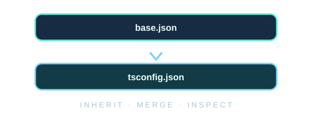

<p align="center">
  
  <br/>
  <br/>   
  <br/>
</p>

## 🧭 Overview

TSConfig Inheritance Map is a dependency-free Node.js CLI that follows relative `extends` references, merges compiler options, and prints the chain behind an effective TypeScript configuration.

## ✨ Features

- 🧬 Follow one or multiple relative `extends` entries.
- 🧩 Merge nested `compilerOptions` from base to child.
- 🚧 Report missing files and inheritance cycles.
- 📝 Accept JSONC comments and trailing commas.
- 📦 Use only Node.js built-in modules.

## 🎬 Demo

The included sample config extends a base config. Run the command below to see the chain and the effective merged options. No hosted demo is claimed.

## 🚀 Quick Start

Requires Node.js 18 or newer.

```bash
npm start -- sample/tsconfig.json
```

Use your own config path:

```bash
node index.js path/to/tsconfig.json
node index.js path/to/tsconfig.json --json
```

## 🧰 Tech Stack

- 🟢 Node.js 18+
- 📄 JSONC parsing with the standard library
- 📦 No external dependencies

## 🗂️ Folder Structure

```text
tsconfig-inheritance-map/
├── assets/mark.svg
├── index.js
├── sample/
│   ├── base.json
│   └── tsconfig.json
├── package.json
├── README.md
├── LICENSE
└── .gitignore
```

## 🛣️ Roadmap

- [ ] Resolve package-based extends through package metadata.
- [ ] Explain selected compiler options in plain language.
- [ ] Export a Graphviz inheritance graph.

## 🤝 Contributing

Add focused fixtures for valid chains, missing parents, and cycles. Run the CLI against the sample before opening a pull request.

## 📄 License

MIT licensed. See [LICENSE](LICENSE).

<p align="center"></p>
